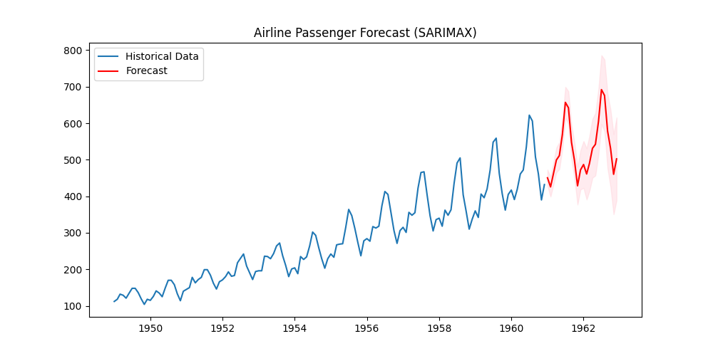

## Seasonal Forecasting with SARIMAX in Azure Databricks

This project demonstrates a classical time-series forecasting workflow using **SARIMAX** in Azure Databricks.

Using historical airline passenger data, the analysis examines trend and seasonality, tests for stationarity, selects model parameters, and produces a 24-month forecast with confidence intervals.

## Analytical objective

The objective is to understand the historical pattern in passenger volumes and estimate how that pattern may evolve over the next 24 months.

The project illustrates a disciplined forecasting sequence:

**Explore the series → assess trend and seasonality → test stationarity → select parameters → fit the model → evaluate and forecast.**

## Modelling workflow

### 1. Time-series exploration

The historical series is examined for trend, seasonal structure, and residual behaviour using visual analysis and decomposition.

### 2. Stationarity testing

The Augmented Dickey–Fuller (ADF) test is used to assess stationarity and inform the differencing strategy.

### 3. Parameter selection

A grid search evaluates candidate SARIMAX configurations:

\[
(p,d,q) \times (P,D,Q,s)
\]

Candidate models are compared using the Akaike Information Criterion (AIC), alongside consideration of model behaviour.

### 4. Forecasting

The selected model generates a 24-month forecast with 95% confidence intervals. The interval communicates forecast uncertainty; it should not be interpreted as a guarantee that future observations will fall within a particular range.

## Implementation environment

The analysis is developed in Azure Databricks using Python and `statsmodels`. The repository includes a notebook, Python implementation, forecast output, and visualization.

| Area | Tools |
|---|---|
| Platform | Azure Databricks |
| Language | Python |
| Data handling | pandas, NumPy |
| Statistical modelling | statsmodels |
| Visualization | Matplotlib, Databricks display |
| Version control / workflow | Databricks Git integration and repository workflow configuration |

## Repository contents

- `Sarimax_model.ipynb` — notebook-based analysis
- `airline.py` — Python implementation
- `forecast_output.csv` — generated forecast output
- `forecast_plot.png` — forecast visualization
- `databricks.yml` — Databricks project configuration

## Position within the broader work

This repository is a focused example of statistical forecasting. It demonstrates the modelling foundations that also matter in broader predictive-intelligence work: understanding temporal patterns, validating assumptions, communicating uncertainty, and interpreting forecasts in context.

For a broader application of predictive modelling to institutional lifecycle questions, see [Data-Driven Foresight](https://github.com/panxiaoyan225-sudo/Data-Driven-Foresight).

**A forecast is useful not because it removes uncertainty, but because it makes uncertainty explicit and supports better planning.**
